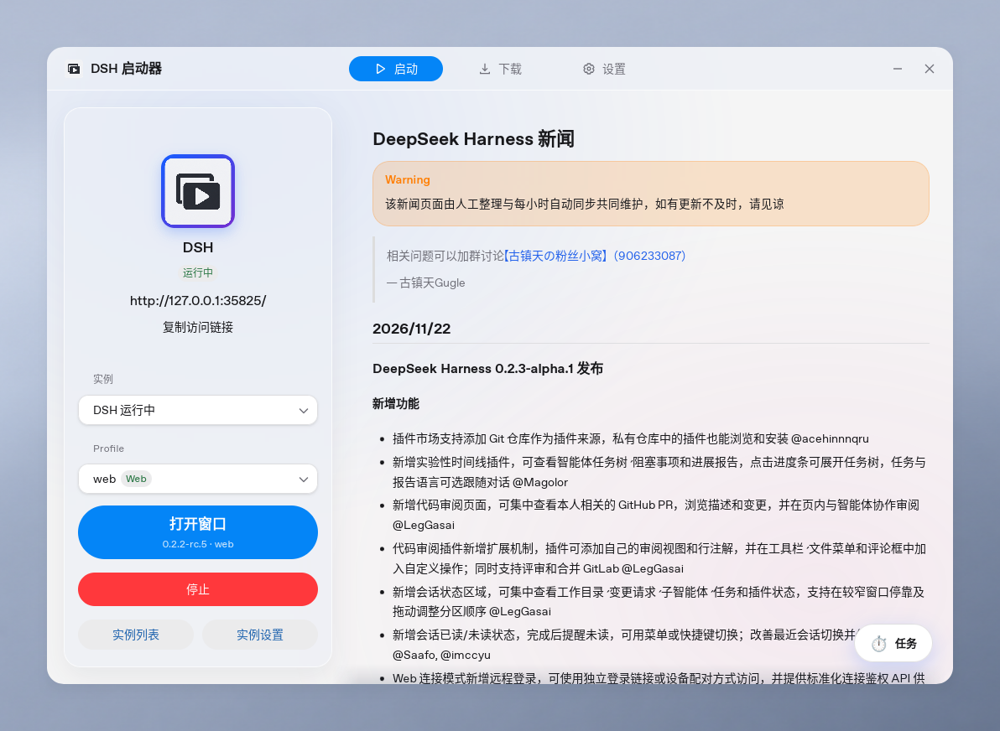
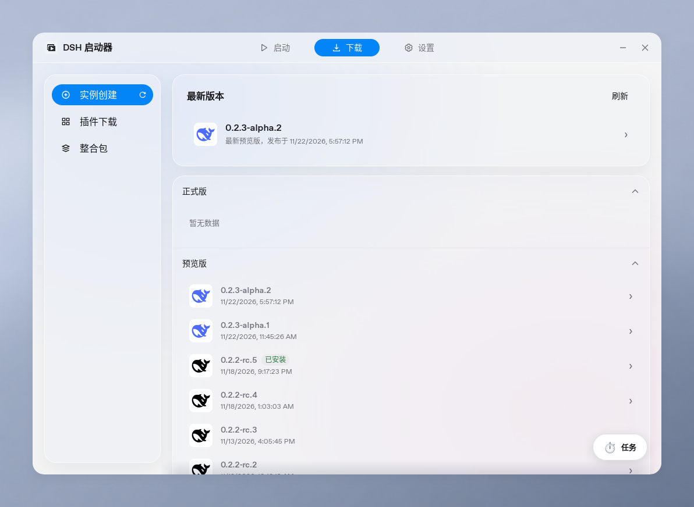
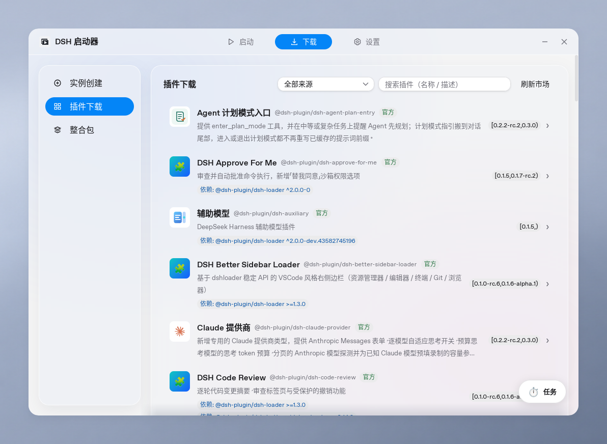
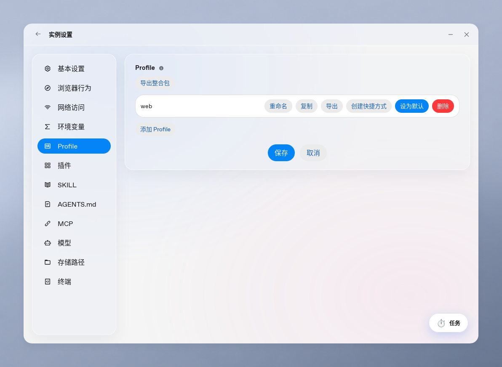
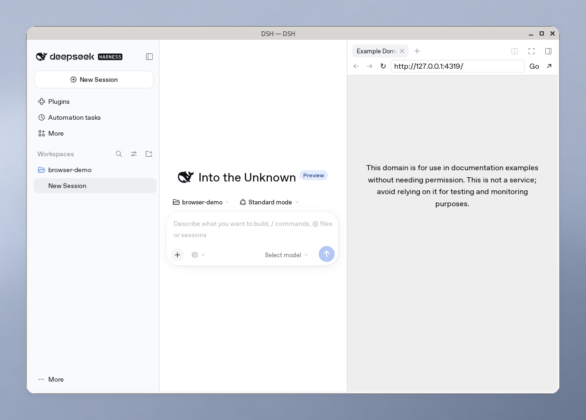
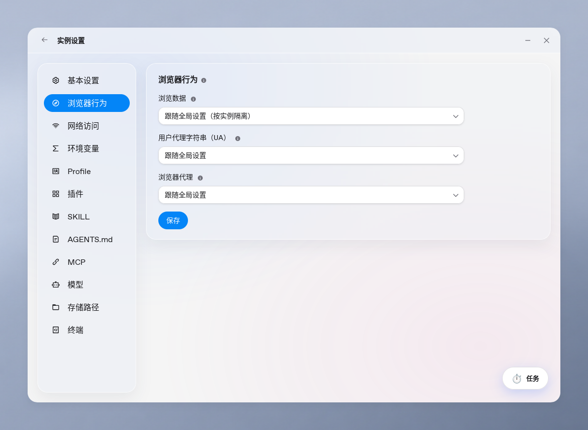

# DSH Launcher

**Install, launch, and manage multiple DeepSeek Harness (DSH) instances in one desktop app.**

English · [简体中文](README.zh_CN.md)

Keep separate setups for daily work and plugin testing, or run the same setup with a different DSH version. The launcher supports Web and terminal (TUI) profiles and lets you manage plugins, modpacks, model providers, MCP servers, and skills. [Learn about DeepSeek Harness](https://github.com/deepseek-ai/deepseek-harness)

## Download and install

Pick the installer for your operating system and processor under **Assets**. This guide covers the current development build, including the embedded browser, notifications, version repair, Computer Use helper settings, and modpack updates. Look for **Pre-release** to try those features. Preview assets vary by release. [Latest stable release](https://github.com/dsh-plugins/dsh-launcher/releases/latest) · [All releases](https://github.com/dsh-plugins/dsh-launcher/releases)

| Operating system | Architecture | Installer |
| --- | --- | --- |
| Windows | x64 | Run the `-setup.exe` installer. |
| macOS | Apple silicon `aarch64`, Intel `x64` | Open the `.dmg` and drag the app into Applications. |
| Linux | x64 `amd64`, ARM64 `arm64` | Install the `.deb` or `.rpm` (x64 only) with your package manager, or make the `.AppImage` executable and run it. |

## Launch your first DSH instance

1. Open DSH Launcher. If you see **Environment Check**, choose **Install Node.js automatically**. This also sets up pnpm. If a supported Node.js is already installed, the launcher sets up pnpm on your first DSH download.
2. Go to **Download → Create instance** and select a DSH version. The **Latest versions** section shows the newest stable and preview builds available.
3. Enter an **Instance name**, keep the default **New dedicated DSH_HOME for this instance**, and select **Start download**. If the version is already installed, select **Create instance**. Open **Tasks** at the bottom right for progress or error logs.
4. Return to **Launch**, choose your instance and its `web` profile, then select **Start**. The DSH Web interface opens in a separate window by default. A TUI profile opens a terminal window.
5. When you're ready to start a conversation, configure a DeepSeek API key or add another provider in **Instance settings → Models**.

On Linux and macOS, keep the default local runtime option. This build labels it **Windows (local)**.

A `DSH_HOME` holds profiles, conversations, and other DSH configuration. Use a dedicated directory to keep those files separate. Instances that reuse a directory share its profiles and conversations and can still run different DSH versions. If you already have a DSH install or a `~/.dsh` directory, open **Settings → Startup → Import local environments → Scan & import…** to bring it into the launcher.

## Screenshots

Screenshots from the Linux desktop app using a sample instance. The desktop compositor draws the outer window corners and shadows.

| Launch | Create instance |
| --- | --- |
|  |  |
| **Plugin marketplace** | **Instance profiles** |
|  |  |

## Embedded browser

Read documentation or other web pages beside your conversation in a DSH Web window opened from the launcher.

1. Open or create a session, then select **Open sidebar** at the top right.
2. Choose **Browser**. If the sidebar already has tabs, use **New tab (+) → Browser**.
3. Enter an `http://` or `https://` address and select **Go**. You can also right-click a link in the conversation and choose **Open in sidebar**.

Each browser tab has back, forward, reload, and **Open in system browser** controls. The embedded browser is available in the Windows, Linux, and macOS 14 or later desktop app. On earlier macOS versions, you can open conversation links in the system browser.

Use **Settings → Browser behavior** for defaults or **Instance settings → Browser behavior** for an individual instance. You can configure the user agent and proxy and choose how cookies and site data are stored.

| Browsing data | Sign-ins and site data |
| --- | --- |
| **Per instance** (default) | Tabs in the same instance share data across restarts. |
| **This run only** | Stopping the instance clears the data. |
| **Shared** | Instances in shared mode use the same data and the global browser proxy. |

Close all tabs that use the same browsing data and reopen them to apply a proxy change.

## Common tasks

| To do this | Open this page |
| --- | --- |
| Change the DSH version, set a default profile, or add environment variables | Open **Instance settings → Basic**, **Profiles**, or **Environment**, respectively. |
| Install, update, or disable plugins | In **Download → Plugins**, select a plugin, version, and target instance profile. The installer shows compatibility before you proceed. Manage installed plugins in **Instance settings → Plugins** and restart the instance to apply changes. |
| Manage skills, MCP servers, or model providers | Open **SKILL**, **MCP**, or **Models** under **Instance settings**. |
| Turn on desktop and tray notifications | Use **Settings → Notifications** to choose system, sound, or tray alerts for Web instances. Alerts cover plans awaiting review, questions awaiting answers, and unseen completions. |
| Open a Web instance from another device | Choose LAN, public direct access, or reverse proxy under **Instance settings → Network access**. Set up HTTPS for access from other devices and keep token-bearing links private. |
| Manage the Computer Use helper | On native Windows or macOS, use **Settings → Computer Use** to manage helper downloads and their location. By default, downloading or repairing a supported DSH version also prepares its matching helper. |

On Windows, you can also select a WSL2 distribution when creating an instance. The launcher sets up DSH and its runtime in that distribution and stores the instance's `DSH_HOME` there. WSL2 instances are experimental.

[Plugin marketplace](https://dsh-plug.in/) · [Notifications guide](docs/NOTIFICATIONS.md) · [DSH public deployment guide](https://deepseek-harness.github.io/deepseek-harness/guide/public-deployments)

## Import, export, and update modpacks

- **Import** a local `.dspack` or legacy `.tgz` file. Choose the file or enter a download URL in **Launch → Instance list → Import modpack**, or browse **Download → Modpacks**. Review the included profiles, select optional resources, and resolve conflicts before applying the pack.
- **Export** one or more custom profiles from **Instance settings → Profiles**. Choose resources such as plugins, skills, MCP servers, and model providers. Recipients enter credentials locally or confirm reuse of existing credentials.
- **Update** from **Update modpack** on the target instance after stopping instances that share its `DSH_HOME`. Updates require a new pack built with manifest v6. Review changes and conflicts before applying. Local content is kept by default when there is a conflict.

## Troubleshooting

- **A download, instance creation, or plugin installation failed.** Open **Tasks** at the bottom right and view the failed task's log.
- **An installed DSH version is missing files.** Stop instances using that version, then choose **Repair files** under **Download → Create instance → Installed versions**.
- **An instance won't launch.** Check **Instance settings → Basic → Files → View log**. Find launcher logs in **Settings → Startup → Logs** and check for launcher updates under **Settings → About**.
- **You need to find your launcher data.** Go to **Settings → Startup → Data directory → Open directory**.

When reporting a problem, include your operating system, launcher version, DSH version, and relevant logs. Remove API keys and access tokens before sharing. [Open a GitHub issue](https://github.com/dsh-plugins/dsh-launcher/issues)

## License

MIT
