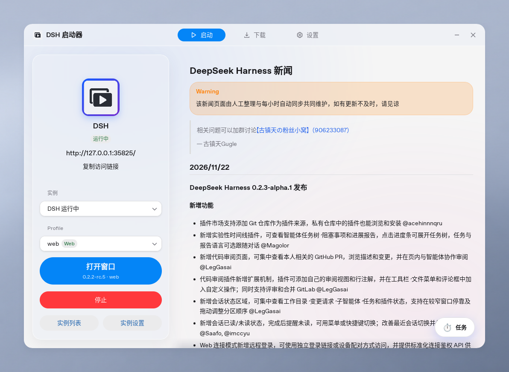
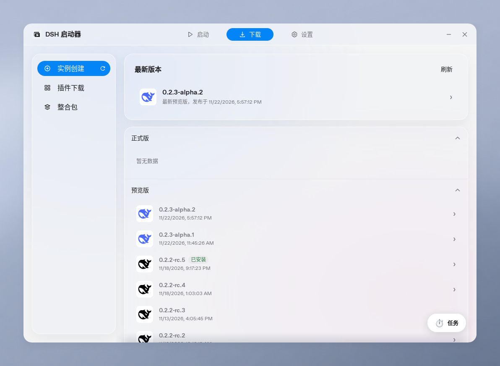
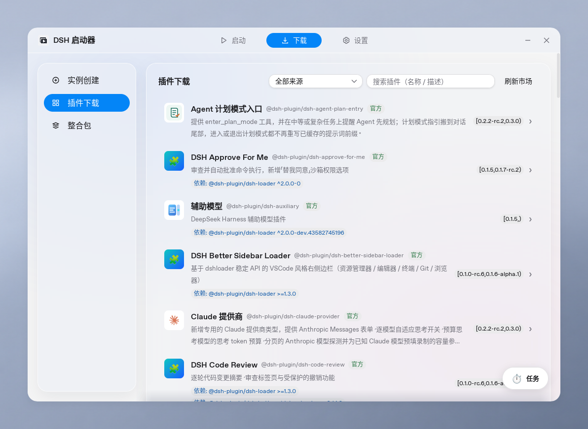
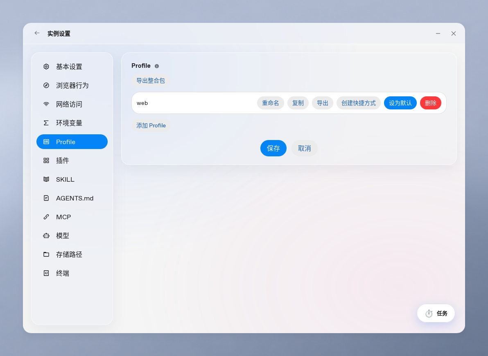
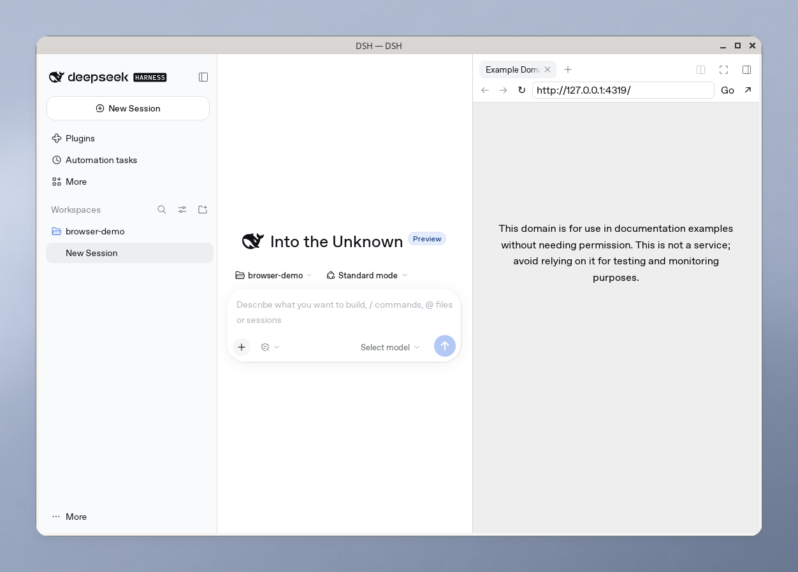
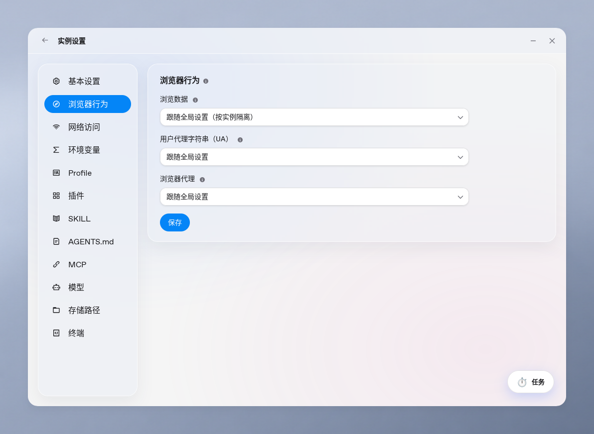

# DSH Launcher

**在一个桌面应用中安装、启动和管理多个 DeepSeek Harness (DSH) 实例。**

[English](README.md) · 简体中文

可以让日常使用和插件测试各用一套配置，也可以给同一套配置切换 DSH 版本。启动器支持 Web 和终端（TUI）Profile，并提供插件、整合包、模型服务商、MCP 和技能管理。[了解 DeepSeek Harness](https://github.com/deepseek-ai/deepseek-harness)

## 下载与安装

在发布页的 **Assets** 中选择对应系统和架构的安装包。本指南以当前开发版为准，嵌入式浏览器、通知、补全版本文件、Computer Use 助手设置和整合包更新可在标有 **Pre-release** 的版本中试用。各预览版的安装包以发布页为准。[最新稳定版](https://github.com/dsh-plugins/dsh-launcher/releases/latest) · [所有版本](https://github.com/dsh-plugins/dsh-launcher/releases)

| 系统 | 架构 | 安装包 |
| --- | --- | --- |
| Windows | x64 | 运行 `-setup.exe` |
| macOS | Apple 芯片 `aarch64`、Intel `x64` | 打开 `.dmg`，将应用拖入「应用程序」 |
| Linux | x64 `amd64`、ARM64 `arm64` | 用系统包管理器安装 `.deb` 或 `.rpm`（仅 x64），也可以授予 `.AppImage` 执行权限后运行 |

## 首次启动 DSH

1. 打开 DSH Launcher。如果出现 **环境检测** 页面，点击 **一键安装 Node.js**，启动器会同时准备 pnpm。如果已有可用的 Node.js，首次下载 DSH 时会准备所需的 pnpm。
2. 打开 **下载 → 实例创建**，选择一个 DSH 版本。**最新版本** 会显示当前可用的最新正式版和预览版。
3. 输入 **实例名称**，保留默认的 **为此实例新建专属 DSH_HOME**，然后点击 **开始下载**。如果该版本已安装，按钮会显示 **创建实例**。下载进度和失败原因可在右下角的 **任务** 中查看。
4. 回到 **启动** 页，选择新实例及其 `web` Profile，点击 **启动**。默认会在独立窗口打开 DSH Web 界面。选择 TUI Profile 会打开终端窗口。
5. 准备发起对话时，可以在 **实例设置 → 模型** 中配置 DeepSeek API 密钥或添加其他模型服务商。

在 Linux 和 macOS 上，保留默认的本机运行选项即可。当前构建将该选项显示为 **Windows 本地**。

`DSH_HOME` 保存 Profile、会话及其他 DSH 配置。专属目录适合隔离数据。多个实例复用同一目录时会共享配置和会话，各实例仍可选择自己的 DSH 版本。已有 DSH 安装或 `~/.dsh` 的用户可以通过 **设置 → 启动 → 导入本机环境 → 扫描并导入…** 查找并导入现有环境。

## 界面预览

截图来自 Linux 桌面版，使用示例实例。窗口外缘的圆角与阴影由桌面合成器绘制。

| 启动页 | 实例创建 |
| --- | --- |
|  |  |
| **插件市场** | **实例 Profile** |
|  |  |

## 嵌入式浏览器

在启动器打开的 DSH Web 窗口里，可以边看文档或其他网页，边使用会话。

1. 打开或创建一个会话，点击右上角的 **打开侧边栏**。
2. 选择 **浏览器**。如果侧边栏已有标签页，点击 **新标签页（+）→ 浏览器**。
3. 输入 `http://` 或 `https://` 地址，点击 **前往**。也可以右键点击会话中的网页链接，选择 **在侧边栏打开**。

浏览器标签页支持后退、前进、刷新，以及 **在系统浏览器中打开**。Windows、Linux 和 macOS 14 及以上版本的桌面端支持内嵌浏览。较早的 macOS 版本可以用系统浏览器打开会话链接。

进入 **设置 → 浏览器行为** 可设定全局默认值，进入 **实例设置 → 浏览器行为** 可为当前实例设置。这里可以配置用户代理（UA）、浏览器代理，以及 Cookie 和网站数据的保存方式。

| 浏览数据 | 登录状态和网站数据 |
| --- | --- |
| **按实例隔离**（默认） | 同一实例的标签页共享数据，实例重启后仍可使用。 |
| **单次运行保留** | 停止实例时清除数据。 |
| **共享** | 选择共享的实例共用数据，并使用全局浏览器代理。 |

更改代理后，关闭使用同一份浏览数据的所有标签页，再重新打开即可生效。

## 日常使用

| 想做什么 | 在哪里操作 |
| --- | --- |
| 更换 DSH 版本、设置默认 Profile 或添加环境变量 | 分别打开 **实例设置 → 基本设置**、**Profile** 或 **环境变量**。 |
| 安装、更新或停用插件 | 在 **下载 → 插件下载** 选择插件、版本和目标实例的 Profile。安装前可查看兼容性。在 **实例设置 → 插件** 管理已安装插件，修改后重启正在运行的实例。 |
| 管理技能、MCP 与模型服务商 | 打开 **实例设置** 中的 **SKILL**、**MCP** 或 **模型**。 |
| 开启桌面和托盘提醒 | 在 **设置 → 通知设置** 选择系统、声音或托盘提醒。支持 Web 实例中的计划待审、提问待答和完成未查看等状态。 |
| 从另一台设备打开 Web 实例 | 在 **实例设置 → 网络访问** 选择局域网、公开直连或反向代理。跨设备访问时配置 HTTPS，并妥善保管含登录令牌的访问链接。 |
| 调整 Computer Use 助手 | 原生 Windows 和 macOS 可在 **设置 → Computer Use** 管理助手目录和下载。启动器默认在下载或补全支持的 DSH 版本时准备匹配的助手。 |

Windows 用户还可以在创建实例时选择 WSL2 发行版。启动器会在发行版内准备 DSH 和运行环境，并在发行版内保存该实例的 `DSH_HOME`。WSL2 实例功能仍处于实验阶段。

[插件市场](https://dsh-plug.in/) · [通知说明](docs/NOTIFICATIONS.md) · [DSH 公开部署指南](https://deepseek-harness.github.io/deepseek-harness/guide/public-deployments)

## 导入、导出与更新整合包

- **导入** · 在 **实例列表 → 导入整合包** 选择本地 `.dspack`、旧版 `.tgz` 或输入下载链接，也可以从 **下载 → 整合包** 浏览市场。预览时可查看包内 Profile、选择可选资源并处理冲突。
- **导出** · 在 **实例设置 → Profile** 导出一个或多个自定义 Profile。可选择插件、技能、MCP 和模型服务商等资源。凭据值由接收方在本机填写或确认复用。
- **更新** · 停止共用该 `DSH_HOME` 的运行实例，在目标实例上选择 **更新整合包**。新版整合包需使用清单 v6。应用前可以预览变更并处理冲突，默认保留本机内容。

## 排查问题

- **下载、创建实例或安装插件失败** · 点击右下角 **任务**，打开失败任务查看日志。
- **已安装的 DSH 版本缺少文件** · 停止使用该版本的实例后，在 **下载 → 实例创建 → 已安装版本** 选择 **补全文件**。
- **实例无法启动** · 在 **实例设置 → 基本设置 → 文件 → 查看日志** 查看实例日志。启动器日志在 **设置 → 启动 → 日志**，版本检查在 **设置 → 关于**。
- **查找启动器数据** · 在 **设置 → 启动 → 数据目录** 点击 **打开目录**。

反馈问题时，请附上系统、启动器版本、DSH 版本和相关日志，并移除 API 密钥与访问令牌。[提交 GitHub Issue](https://github.com/dsh-plugins/dsh-launcher/issues)

## 许可证

MIT
