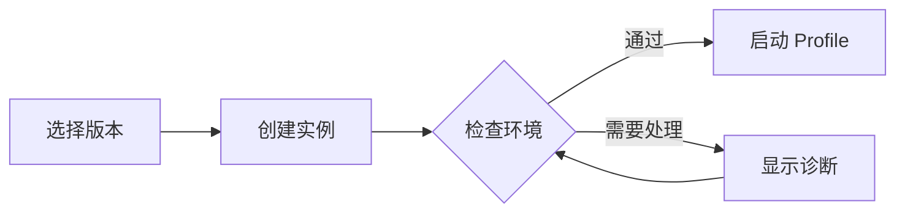
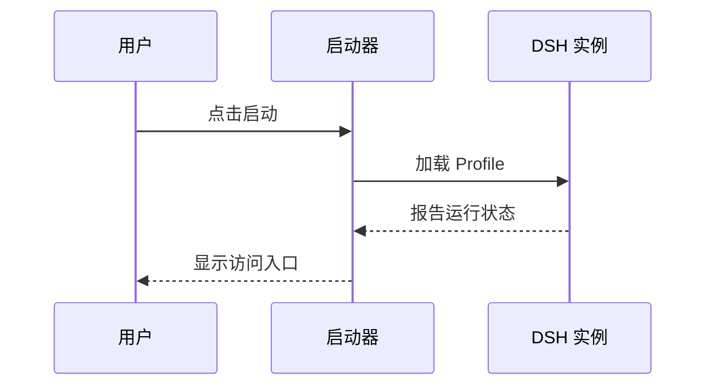

# DSH Launcher · Markdown 格式预览

这是一份完整的排版样例，用来检查新闻区域的文字、列表、表格、代码、公式和图示在深浅主题下的效果。

快速跳转：[基础文字](#preview-text) · [列表](#preview-lists) · [引用与提示](#preview-alerts) · [表格](#preview-tables) · [代码](#preview-code) · [公式](#preview-math) · [图示](#preview-diagrams) · [图片与折叠](#preview-media)

---

<a id="preview-text"></a>

## 1. 基础文字与标题

普通正文应该有清楚的行距，较长的段落也应容易阅读。这里混合中文、English、数字 0123456789，以及标点符号：，。！？「」《》（）。

**粗体强调**、*斜体强调*、***粗斜体***、~~删除线~~、<u>下划线</u>、<mark>高亮文字</mark>，以及 `inline-code`。

上标：x<sup>2</sup>；下标：H<sub>2</sub>O。

键盘按键：<kbd><span class="kbd-symbol">⌘</span>K</kbd> <kbd><span class="kbd-symbol">⇧</span>P</kbd> <kbd><span class="kbd-symbol">⌃</span>C</kbd> <kbd><span class="kbd-symbol">⌥</span>D</kbd>

组合按键：<kbd>Ctrl</kbd> + <kbd>Enter</kbd>。

这是同一段中的第一行。
这是显式换行后的第二行。

### 三级标题：功能说明

用一小段正文观察标题和内容之间的间隔。

#### 四级标题：配置项目

四级标题下的正文与其他段落保持一致。

##### 五级标题：补充说明

较小标题仍然需要足够清晰。

###### 六级标题：细节备注

这是最小一级标题对应的正文。

[项目主页](https://github.com/dsh-plugins/dsh-launcher) · <https://github.com/dsh-plugins/dsh-ui-components> · [带说明的链接](https://github.com/dsh-plugins/dsh-launcher "在浏览器中打开启动器项目")

<a id="preview-lists"></a>

## 2. 列表与任务清单

### 无序列表

- 安装多个 DSH 版本。
- 使用不同的实例和 Profile。
  - `web`：浏览器界面。
  - `tui`：终端界面。
    - 嵌套条目也应保留项目符号和缩进。
- 管理插件、技能和 MCP 服务。

### 有序列表

1. 选择一个可用版本。
2. 创建实例。
   1. 填写实例名称。
   2. 选择 DSH_HOME。
3. 选择 Profile 并启动。

### 任务清单

- [x] 已完成：安装运行环境。
- [x] 已完成：创建第一个实例。
- [ ] 待完成：检查插件兼容性。
  - [x] 已检查版本范围。
  - [ ] 等待手动确认。

<a id="preview-alerts"></a>

## 3. 引用与提示块

> 这是一段普通引用。它应该有独立的左侧标记、底色和适当的内边距。
>
> 引用中可以包含 **强调**、[链接](https://github.com/dsh-plugins/dsh-launcher) 和 `代码`。
>
> > 这是一层嵌套引用。

> [!NOTE]
> 信息提示：用于补充背景和阅读说明。

> [!TIP]
> 小技巧：可以为不同用途的实例选择不同的 Profile。

> [!IMPORTANT]
> 重要说明：升级前请阅读对应版本的变更记录。

> [!WARNING]
> 警告提示：修改运行环境可能需要重新启动实例。

> [!CAUTION]
> 谨慎操作：删除版本目录前请检查是否还有实例引用。

<a id="preview-tables"></a>

## 4. 表格

表头、行高、分隔线、圆角和悬浮底色与启动器的设置表格保持一致。

| 名称 | 当前版本 | 状态 | 说明 |
| :--- | :---: | :---: | :--- |
| 默认 DSH_HOME | `0.1.0-rc.6` | ✅ 可用 | 日常工作环境 |
| 实验环境 | `0.1.0-rc.5` | ⏸ 已停止 | 用于测试插件 |
| 新实例 | — | ⏳ 待创建 | 支持 **粗体** 和 [项目链接](https://github.com/dsh-plugins/dsh-launcher) |

### 对齐与较长内容

| 左对齐 | 居中 | 右对齐 |
| :--- | :---: | ---: |
| 插件数量 | 稳定版 | 12 |
| 下载任务 | 进行中 | 3 |
| 兼容性检查 | 已完成 | 100% |

### 宽表横向滚动

| 插件 ID | 版本 | Profile | 来源地址 | 安装目录 | 说明 |
| --- | --- | --- | --- | --- | --- |
| `@dsh-plugin/dsh-auxiliary` | `0.5.0` | `web` | `https://example.com/catalog/preview/plugins/index.json` | `C:\Users\Administrator\.dsh\plugins\dsh-auxiliary` | 用来观察长路径和长地址是否撑破页面 |
| `@dsh-plugin/dsh-thought-buddy` | `0.3.1` | `demo` | `https://example.com/catalog/preview/community/plugins.json` | `D:\DSH\instances\preview\plugins\dsh-thought-buddy` | 表格只在自己的区域内横向滚动 |

<a id="preview-code"></a>

## 5. 行内代码与代码块

行内代码：`pnpm dev`、`DSH_HOME`、`plugins[0].enabled = true`。

```typescript
interface Profile {
  name: string
  kind: 'web' | 'tui'
  enabled: boolean
}

const profile: Profile = {
  name: 'preview',
  kind: 'web',
  enabled: true,
}

console.log(`启动 ${profile.name}`)
```

```json
{
  "name": "预览实例",
  "profile": "web",
  "plugins": ["@dsh-plugin/dsh-auxiliary"],
  "enabled": true
}
```

```shell
# 长命令应在代码块内横向滚动
pnpm example --instance preview --profile web --config C:/Users/Administrator/.dsh/preview/configuration/settings.json
```

```html
<section class="example">
  <h2>HTML 代码应作为文字显示</h2>
  <p>保留缩进和尖括号，不执行其中的内容。</p>
</section>
```

<a id="preview-math"></a>

## 6. 数学公式

行内公式： $E = mc^2$ 与 $a^2 + b^2 = c^2$ 。

$$
f(x) = \frac{1}{\sqrt{2\pi\sigma^2}}\exp\left(-\frac{(x-\mu)^2}{2\sigma^2}\right)
$$

$$
\sum_{i=1}^{n} i = \frac{n(n+1)}{2}
\qquad
\begin{pmatrix} 1 & 2 \\ 3 & 4 \end{pmatrix}
$$

<a id="preview-diagrams"></a>

## 7. Mermaid 图示





<a id="preview-media"></a>

## 8. 图片、折叠与内联 HTML


<details>
<summary>展开查看详细说明</summary>

折叠区域可以包含普通段落、**强调文字** 和列表。

- 配置名称：`preview`
- 配置用途：格式检查

```json
{ "expanded": true }
```

</details>

<p>安全的内联 HTML：<strong>加粗</strong>、<em>斜体</em>、<small>辅助文字</small>、<sub>下标</sub> 和 <sup>上标</sup>。</p>

## 9. 剧透内容与脚注

未揭示的内容：>!这段文字应被遮住，悬浮或点击后显示。!<

也可以包含格式：>!**重点内容** 与 `inline-code`。!<

这里是一条脚注引用[^preview]，这里是另一条脚注[^layout]。

---

预览结束。可以逐项检查颜色、行距、缩进、圆角、横向滚动和长内容的裁剪效果。

[^preview]: 脚注正文应该比普通段落更紧凑，并能通过回链跳回引用位置。
[^layout]: 包含 **强调** 和 `代码` 的脚注，供检查底部排版使用。
